```mermaid
gantt
    title نقشه راه پیاده‌سازی پروژه باشگاه ورزشی
    dateFormat  X
    axisFormat %d
    section فازهای پروژه
    فاز ۱: محیط و ابزارها             :p1, 0, 1
    فاز ۲: طراحی مدل‌ها و دیتابیس     :p2, 1, 3
    فاز ۳: کاتالوگ و APIهای پایه      :p3, 3, 5
    فاز ۴: موتور رزرو و همزمانی       :p4, 5, 8
    فاز ۵: Idempotency و پرداخت        :p5, 8, 10
    فاز ۶: لیست انتظار هوشمند         :p6, 10, 12
    فاز ۷: تست فشار و شبیه‌سازی       :p7, 12, 14
```

# Project Implementation Roadmap & Phases (مراحل و فازبندی پیاده‌سازی)

این سند مراحل پیاده‌سازی پروژه را از صفر تا فاز نهایی (تست استرس و استقرار) به صورت گام‌به‌گام مشخص می‌کند.

---

---

## 🏗️ فاز ۱: راه‌اندازی زیرساخت و ابزارها (Infrastructure Setup)
- [x] نصب و تنظیم **Django REST Framework (DRF)**.
- [x] افزودن تنظیمات توسعه، متغیرهای محیطی (`.env`) و فایل `.gitignore`.
- [ ] تنظیم ابزار مستندسازی API (مثل `drf-spectacular` یا `drf-yasg` برای Swagger).
- [x] آماده‌سازی کانفیگ دیتابیس PostgreSQL برای محیط توسعه.

---

## 🗄️ فاز ۲: طراحی دامنه و مدل‌های دیتابیس (Domain Modeling & Schema)
- [x] ایجاد اپلیکیشن‌های مجزا:
  - `accounts`: مدل کاربر سفارشی (User) و نقش‌ها (Client, Trainer, Admin).
  - `gym_sessions`: مدل مربیان (Trainers)، سانس‌ها (Sessions)، ظرفیت‌ها و قیمت‌ها.
  - `bookings`: مدل رزرو (Booking) و ماشین وضعیت (`AVAILABLE`, `HELD`, `CONFIRMED`, `CANCELLED`, `EXPIRED`).
  - `waitlist`: مدل صف انتظار (WaitlistEntry) با کلیدهای اولویت زمانی.
- [x] اعمال محدودیت‌های یکپارچگی (Database Constraints & Unique Constraints).
- [x] ساخت مایگریشن‌ها و ایجاد پنل ادمین جنگو برای تست و ورود اطلاعات آزمایشی.

---

## ⚡ فاز ۳: کاتالوگ سانس‌ها و APIهای عمومی (Catalog & Read Path)
- [x] ساخت Serializerهای اختصاصی برای مربیان و برنامه‌های هفتگی.
- [x] پیاده‌سازی اندپوینت‌های خواندن:
  - `GET /api/v1/sessions/`: مشاهده سانس‌های هفته با قابلیت فیلتر.
  - `GET /api/v1/sessions/{id}/`: مشاهده جزئیات سانس، ظرفیت باقی‌مانده و قیمت.
- [x] بهینه‌سازی کوئری‌ها با `select_related` و `prefetch_related` جهت جلوگیری از باگ N+1.
- [ ] ایندکس‌گذاری فیلدهای پرکاربرد جستجو (`date`, `trainer_id`, `status`) - *مکول به فاز ۷ تست استرس*.

---

## 🛡️ فاز ۴: موتور ضد تداخل همزمانی و قفل ۱۰ دقیقه‌ای (Concurrency & Hold Engine)
- [ ] پیاده‌سازی اندپوینت ایجاد قفل موقت:
  - `POST /api/v1/sessions/{id}/hold/`
- [ ] پیاده‌سازی تراکنش اتمیک با قفل بدبینانه سطری:
  - استفاده از `transaction.atomic()` و `select_for_update()` روی ردیف سانس.
- [ ] ثبت زمان انقضا (`expires_at = now + 10 minutes`).
- [ ] پیاده‌سازی تسک پس‌زمینه (Background Worker / Celery یا Management Command) برای شناسایی و منقضی کردن رزروهای پرداخت‌نشده بعد از ۱۰ دقیقه.

---

## 💳 فاز ۵: ایمنی پرداخت و تکرارپذیری (Idempotency & Payment Simulation)
- [ ] پیاده‌سازی میدلور یا دکوراتور `Idempotency-Key` برای بررسی درخواست‌های تکراری در هدر.
- [ ] پیاده‌سازی درگاه پرداخت شبیه‌سازی‌شده (Mock Payment Gateway):
  - `POST /api/v1/bookings/{id}/pay/`
- [ ] تغییر اتمیک وضعیت رزرو از `HELD` به `CONFIRMED`.
- [ ] جلوگیری قطعی از شارژ دوگانه در صورت چند بار کلیک متوالی.

---

## ⏳ فاز ۶: لیست انتظار هوشمند و انتقال خودکار نوبت (Smart Waitlist)
- [ ] پیاده‌سازی اندپوینت ثبت‌نام در لیست انتظار:
  - `POST /api/v1/sessions/{id}/waitlist/`
- [ ] پیاده‌سازی هوک یا رویداد آزادسازی سانس (بر اثر Cancel یا Expiry):
  - سیستم به صورت خودکار نفر اول صف را برمی‌دارد و سانس را برای او قفل ۱۰ دقیقه‌ای می‌کند.
  - شبیه‌سازی ارسال نوتیفیکیشن / پیامک به کاربر با زمان‌بندی مهلت ۱۰ دقیقه.

---

## 🚀 فاز ۷: تست استرس، شبیه‌سازی ترافیک ساعت ۸ شب و تاییدیه نهایی (Stress Testing & Verification)
- [ ] نوشتن اسکریپت تست همزمانی خودکار با Python (`asyncio` / `httpx` یا `Locust`):
  - ارسال ۱۰۰ درخواست موازی در یک کسر از ثانیه برای رزرو یک سانس ۱ به ۱.
  - اعتبارسنجی خروجی دیتابیس (دقیقاً ۱ رکورد موفق و ۹۹ رکورد با خطای ۴۰۹).
- [ ] بررسی لاگ‌ها، مانیتورینگ عملکرد و بهینه‌سازی کش با Redis.
- [ ] تکمیل مستندات نهایی Swagger و تهیه راهنمای اجرای پروژه (`README.md`).
